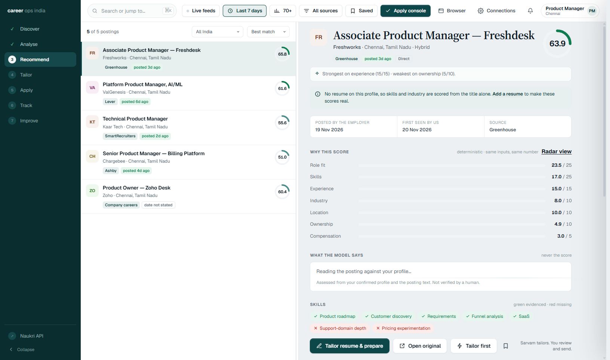

<div align="center">

# Career-Ops India

### Find the roles you actually fit. Tailor a resume for each. Apply with you in the loop.

**Free to use. Open source. FOSS. Runs on your own machine.**

[](LICENSE)
[](https://nodejs.org)
[](#quick-start)
[](CONTRIBUTING.md)

[**Live site**](https://career-ops-india.pages.dev) · [**Quick start**](#quick-start) · [**How it works**](#how-it-works) · [**Docs**](#docs)

</div>

## Start with your agent

You already have Claude, Codex, Cursor, Kimi, Gemini, Copilot, Hermes or n8n.
Copy the prompt below, paste it as your first message, and the agent checks your
machine, clones the repo, starts the app and walks you through your first search.

```text
You are setting up Career Ops India on my computer. It is a free, open-source, local-first job-search workspace (AGPL-3.0). It runs on my machine; nothing is hosted.

GOAL
Get it running at http://localhost:4173 and walk me through my first job search.

RULES
- Ask before installing anything system-wide. Use what is already installed when you can.
- Never ask for my passwords, and never type them.
- Never submit a job application without my explicit yes for that specific job.
- If a step fails, show me the exact error, try one alternative, then stop and ask.

STEP 1 - CHECK MY MACHINE
Run these and report the versions:
  node --version
  pnpm --version
  git --version
I need Node 22 or newer. If pnpm is missing: npm install -g pnpm
If Node is older than 22, tell me how to update it for my OS and wait for me.

STEP 2 - GET THE CODE
  git clone https://github.com/scholarvault/Career-Ops-India.git
  cd Career-Ops-India

STEP 3 - INSTALL AND START
  pnpm install
  pnpm start
The app serves http://localhost:4173 and `pnpm start` opens it in my browser. If it does not open, open the URL yourself. Confirm it responds before you continue. If the port is busy: pnpm stop

STEP 4 - OPEN IT
Open http://localhost:4173/ in my browser. That is the setup page; finish it and it takes me to the workspace.

STEP 5 - MY FIRST RUN, ONE STEP AT A TIME
Wait for me at each step.
1. Ask me to upload my resume (PDF or DOCX) and confirm the role I am targeting.
2. Show the market counts for my role and my city.
3. Recommend 10 jobs and explain the top 3 scores in one line each.
4. Tailor a resume for the job I pick. This needs an AI key; if I do not have one, tell me where to paste it in Connections - the gear button in the workspace top bar, or Connections at the bottom of the apply console.
5. Fill one application form. Stop before submit and show me exactly what it filled.

OPTIONAL
The repo ships an MCP server (pnpm mcp) with tools for search, scoring, shortlisting, tailoring and applying. Claude Code, Codex and Gemini CLI pick it up automatically inside the repo; run `pnpm connect` to use it from anywhere. For Claude Desktop, Settings → AI and agents → Get the plugin builds a plugin zip to upload in Claude (Plugins → Upload a plugin).

WHEN DONE
Tell me the local URL, what is running, and the single next thing I should do. Keep it short.
```

If your agent cannot run commands, it prints them for you to run. Same result,
one copy-paste at a time.


<p align="center"><em>Seven steps, about five minutes. Every answer stays editable.</em></p>

---

## What it is

A job-search workspace for the Indian market. It finds postings, scores them
against your resume, shows you the market around a role, tailors one resume per
job, and fills the application form — asking you only when it has to.

No account. No subscription. No telemetry. Your resume, your applications and
your browser sessions stay in `data/` on your machine.


## Why Career-Ops India (vs Cloud Auto-Appliers & Frontier Models Alone)

Frontier models (Claude, Codex, Gemini) can browse sites and rewrite text, while cloud bots charge subscriptions for black-box blasting. Career-Ops India gives both **your UI** and **any AI agent** deterministic infrastructure:

| Strength | What it does differently |
|---|---|
| **Deterministic 100-pt Scoring** | Ranks Indian ATS feeds, Naukri, and Indeed reproducibly across role, skills, experience, location, industry, and salary — never hallucinates a match score or burns tokens scanning 1,000+ raw pages in chat. |
| **Situational Zero-Invention Tailoring** | Decides when to keep your **Original Master Resume** (direct domain matches / thin JDs) vs when to **Tailor** ATS vocabulary, while verifying every employer, role, date, and metric against your baseline (**0 invented facts**). |
| **Human-in-the-Loop Approval Gate** | Never guesses Current CTC, Notice Period, or custom motivation answers; pauses on OTP/CAPTCHA and uses hash-bound approval (`needsApproval`) before submitting. |
| **India-Native Execution** | Direct company ATS JSON connectors (Freshworks, ValGenesis, NETGEAR, Swiggy, Meesho, Paytm, Zeta, etc.) + user-session Naukri & Indeed India, duplicate prevention, and daily caps. |
| **Agent-Native Dual Surface** | One Zod-validated layer powers MCP (`pnpm mcp`), WebMCP (`navigator.modelContext`), `view_screen`/`navigate` context awareness, CLI (`pnpm doctor`), and static `ui-sdk` HTML prototypes. |

## Who it is for

- Job seekers in India who are tired of applying into a void.
- People switching roles, not just titles — it shows the adjacent roles your
  experience already covers.
- Anyone who wants to see and approve every application, not hand a bot their
  inbox and hope.

## How it works

Setup runs once. After that the app is three places, with Settings behind the gear:

| Place | What happens there |
|---|---|
| **Find** | One search across every source you have, streamed in as each answers (the first postings in a few seconds). Every posting is scored out of 100 against your resume. Filter by match, posted date, state, city and source; tick postings and **Add to queue**. **Search the web** runs your own Firecrawl or TinyFish search across career sites and Indian boards. |
| **Queue** | Each job gets **Master** (your resume as it is, no AI call) or **Tailor** (reordered toward the posting), suggested from how many of the posting's terms your resume already shows. Then auto apply fills and submits, and asks you only for an OTP, a captcha or an answer it does not have. |
| **Results** | What was sent, each with the site's confirmation; interviews; the pipeline; an activity map; and which source each application came from. Jobs already on Naukri's applied list are counted too. |

- **Scores** come from a fixed 100-point model, so the ranking is the same every
  time. A model writes the explanation, never the number.
- **Tailoring never invents.** It reorders what your resume already says; a
  skill or metric you do not have stays missing.
- **The Career-Ops window.** The app drives its own Chrome, kept out of sight.
  When a site needs you (a sign-in, an OTP, a captcha, a form to check), that
  window comes to the middle of your screen; when you are done, it goes back.

## Screenshots

### The workspace

Every posting, scored. The radar shows where the score came from, and the
weakest dimension is named in plain words.



### Connections

What the app can reach, and the key it uses. Public feeds need no login.


## Quick start

You need Node 22+, pnpm and Chrome.

```bash
pnpm install
pnpm start        # app + API on http://localhost:4173, opens your browser
pnpm stop         # stop it
```

`pnpm start` opens **http://localhost:4173/**: the seven-step setup the first time, then **Find** every time after. Your profile, AI keys, agents, job-site sign-ins and search keys live in **Settings** (the gear in the top bar).

```bash
pnpm demo         # discover, score and plan one real posting, no submit
pnpm mcp          # MCP server on stdio, for Claude, ChatGPT or Codex
pnpm typecheck
pnpm check:doctor # secrets, SourcePolicy contracts & UI persistence invariants
pnpm test:extract # resume extraction, in a real browser
```

## Signing in to job sites

Settings → Job sites has a card per site. **Connect** opens the site's own
sign-in in the Career-Ops window; you sign in there (OTP, email code, Google or
a password typed on the site), the app notices you are in, and the window
goes away. Naukri signs in with your phone or email and a one-time code inside
the app. Advanced: attach your own Chrome, Brave or Edge for chosen sites.

## What it connects to

| Kind | Sources | How |
|---|---|---|
| Your accounts | Naukri, foundit, Indeed India, Wellfound | Your own signed-in session, on this computer |
| Public pages | Apna | Its public role-and-city page |
| ATS feeds | Lever, Greenhouse, Ashby, SmartRecruiters | Public JSON boards of Indian employers |
| Company career pages | Amazon, EPAM, Tesla and more | Their public feeds |
| Search engines | Firecrawl, TinyFish (your free key) | Single postings from Workday, SuccessFactors, Oracle, iCIMS career sites, and Shine, TimesJobs, Instahyre, Cutshort, Hirist, iimjobs, Internshala |
| Remote boards | Himalayas, Remotive, Remote OK, Jobicy, Working Nomads, Freelancer.com | Open feeds |
| LinkedIn | Licensed aggregators with your own key | Filled for you; you press Submit. Never auto-submitted. |

Most sources need no account and nothing in the default path costs money.
Unrelated roles from the company boards are left out, with a count.

## Guardrails

| Guard | What it does |
|---|---|
| Daily cap | A fixed number of submissions per day. A failed attempt does not use one. |
| Audit log | Every send is appended to a local log: when, where, what happened. |
| Pacing | A jittered delay between fields and before navigation. |
| Take control | One switch makes every connector stop touching the page. |
| Captcha | Never solved. You clear it in the browser and hand it back. |
| OTP | Never stored. It is used once, in the run that asked for it. |

A blocked page is a hand-off, never a bypass. "Submitted" requires the site's
confirmation, not a click.

## Other agents

The same flow is available without the page:

- **Claude, Codex, Gemini** — already wired inside the repo (`.mcp.json`, `.codex/config.toml`, `.gemini/settings.json`). `pnpm connect` registers it globally, or press Connect in Settings → AI and agents. See [docs/agents.md](docs/agents.md).
- **Claude Desktop** — Settings → AI and agents → **Get the plugin** builds a plugin zip for Claude's Plugins → Upload a plugin. It starts the server from your clone; it holds no key and no profile.
- **MCP** — `pnpm mcp` starts a server with tools for search, scoring, the
  market summary, shortlisting, tailoring, running a batch, answering a
  question, resuming a batch and reading site memory.
- **Skill** — `.agents/skills/career-ops-apply/SKILL.md` for agents that do not
  speak MCP.

## Your data

Your files stay on your machine. The app does not upload them anywhere except
the AI provider you configure, and only when you tailor or explain a posting.

| What | Where |
|---|---|
| API key | `data/secrets.json` or `.env` |
| Resume, profile, contact details | `data/resume.json`, `data/profile.json` |
| Tailored PDFs | `data/tailored/` |
| Site memory | `data/sites.json` |
| Browser sessions | `data/browser-profile*/` |
| Application log | `data/applications.jsonl` |
| Job-site sign-ins | `data/site-sessions.json` (when; the session itself is in the browser profile) |

`data/` is gitignored. `pnpm check:secrets` fails if a key or a real contact
detail reaches a tracked file. Enable the pre-commit hook once per clone:

```bash
git config core.hooksPath .githooks
```

## Bring your own key

Nothing is bundled. Without a key the app still discovers, scores and plans;
tailoring and explanations ask for one. Set it in **Connections**, or set
`SARVAM_API_KEY` in `.env` for a deploy.

## Free and open source

Career-Ops India is free software under the **AGPL-3.0-or-later**. Use it, fork
it, change it, run it for your friends. If you run a modified version as a
network service, publish your changes.

Contributions are welcome — see [CONTRIBUTING.md](CONTRIBUTING.md). Bug reports
and feature requests go in [Issues](https://github.com/scholarvault/Career-Ops-India/issues).

## Docs

- [Plan](docs/PLAN.md) — decisions, milestones, risks.
- [Decisions](docs/decisions.md) — the ADRs behind them.
- [Agents](docs/agents.md) — Claude, Codex and Gemini setup.
- [Architecture](docs/architecture/README.md) — packages, contracts, scoring.
- [Source register](docs/source-register/README.md) — what each platform allows.
- [Changelog](CHANGELOG.md) — what changed in each release.

## Licence

AGPL-3.0-or-later. See [LICENSE](LICENSE).
