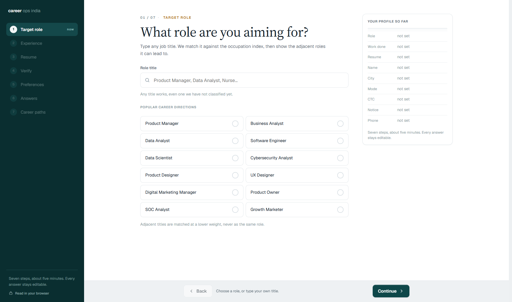
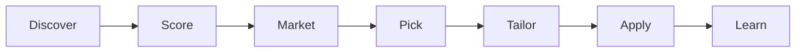
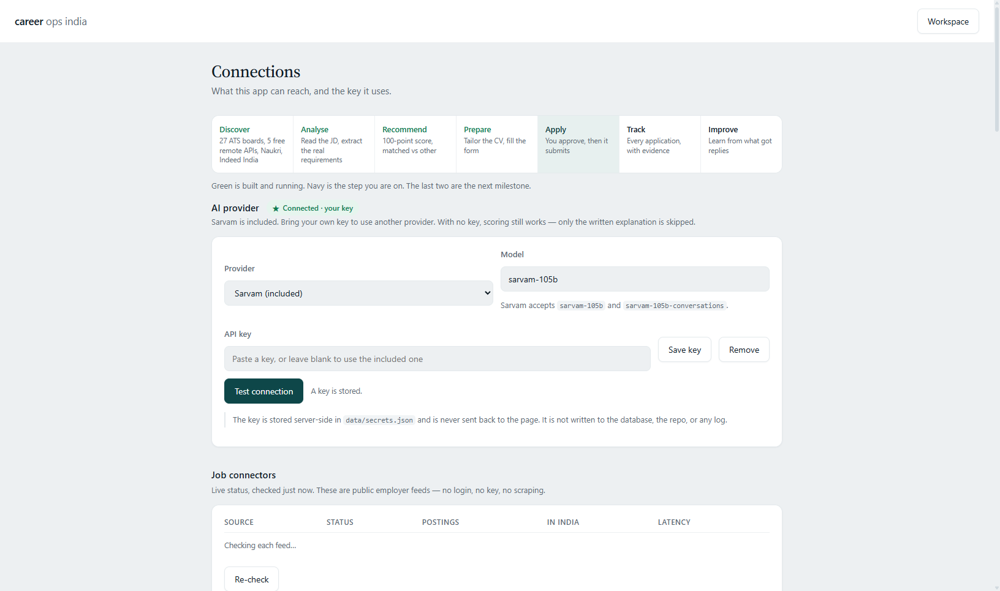

<div align="center">

# Career-Ops India

### Find the roles you actually fit. Tailor a resume for each. Apply with you in the loop.

**Free to use. Open source. FOSS. Runs on your own machine.**

[](LICENSE)
[](https://nodejs.org)
[](#quick-start)
[](CONTRIBUTING.md)

[**Live site**](https://career-ops-india.pages.dev) · [**Quick start**](#quick-start) · [**How it works**](#how-it-works) · [**Docs**](#docs)

</div>

## Start with your agent

You already have Claude, Codex, Cursor, Kimi, Gemini, Copilot, Hermes or n8n.
Copy the prompt below, paste it as your first message, and the agent checks your
machine, clones the repo, starts the app and walks you through your first search.

```text
You are setting up Career Ops India on my computer. It is a free, open-source, local-first job-search workspace (AGPL-3.0). It runs on my machine; nothing is hosted.

GOAL
Get it running at http://localhost:4173 and walk me through my first job search.

RULES
- Ask before installing anything system-wide. Use what is already installed when you can.
- Never ask for my passwords, and never type them.
- Never submit a job application without my explicit yes for that specific job.
- If a step fails, show me the exact error, try one alternative, then stop and ask.

STEP 1 - CHECK MY MACHINE
Run these and report the versions:
  node --version
  pnpm --version
  git --version
I need Node 22 or newer. If pnpm is missing: npm install -g pnpm
If Node is older than 22, tell me how to update it for my OS and wait for me.

STEP 2 - GET THE CODE
  git clone https://github.com/scholarvault/Career-Ops-India.git
  cd Career-Ops-India

STEP 3 - INSTALL AND START
  pnpm install
  pnpm start
The app serves http://localhost:4173 and `pnpm start` opens it in my browser. If it does not open, open the URL yourself. Confirm it responds before you continue. If the port is busy: pnpm stop

STEP 4 - OPEN IT
Open http://localhost:4173/ in my browser. That is the setup page; finish it and it takes me to the workspace.

STEP 5 - MY FIRST RUN, ONE STEP AT A TIME
Wait for me at each step.
1. Ask me to upload my resume (PDF or DOCX) and confirm the role I am targeting.
2. Show the market counts for my role and my city.
3. Recommend 10 jobs and explain the top 3 scores in one line each.
4. Tailor a resume for the job I pick. This needs an AI key; if I do not have one, tell me where to paste it in Connections - the gear button in the workspace top bar, or Connections at the bottom of the apply console.
5. Fill one application form. Stop before submit and show me exactly what it filled.

OPTIONAL
The repo ships an MCP server (pnpm mcp) with tools for search, scoring, shortlisting, tailoring and applying. If you support MCP, offer to connect it.

WHEN DONE
Tell me the local URL, what is running, and the single next thing I should do. Keep it short.
```

If your agent cannot run commands, it prints them for you to run. Same result,
one copy-paste at a time.



<p align="center"><em>Seven steps, about five minutes. Every answer stays editable.</em></p>

---

## What it is

A job-search workspace for the Indian market. It finds postings, scores them
against your resume, shows you the market around a role, tailors one resume per
job, and fills the application form — asking you only when it has to.

No account. No subscription. No telemetry. Your resume, your applications and
your browser sessions stay in `data/` on your machine.

## Who it is for

- Job seekers in India who are tired of applying into a void.
- People switching roles, not just titles — it shows the adjacent roles your
  experience already covers.
- Anyone who wants to see and approve every application, not hand a bot their
  inbox and hope.

## How it works



- **Discovers** postings from Indian boards, company career pages, ATS feeds and
  remote job boards.
- **Scores** every posting against your resume with a fixed 100-point model, so
  the ranking is the same every time.
- **Shows the market** for a role: all India, remote, a state, a city, the last
  seven days, and the role families around it.
- **Tailors** one resume per job, saved as a PDF.
- **Applies** with you in the loop: it fills the form, asks only when it must,
  and records the confirmation the site showed.
- **Learns** each site, so the next form on that site needs fewer answers.

## Screenshots

### The workspace

Every posting, scored. The radar shows where the score came from, and the
weakest dimension is named in plain words.


### Connections

What the app can reach, and the key it uses. Public feeds need no login.



## Quick start

You need Node 22+, pnpm and Chrome.

```bash
pnpm install
pnpm start        # app + API on http://localhost:4173, opens your browser
pnpm stop         # stop it
```

`pnpm start` opens **http://localhost:4173/** - the seven-step setup, which ends in the workspace. The apply console is at **http://localhost:4173/console.html**. AI keys and job sources live in **Connections** (the gear in the workspace top bar).

```bash
pnpm demo         # discover, score and plan one real posting, no submit
pnpm mcp          # MCP server on stdio, for Claude, ChatGPT or Codex
pnpm typecheck
pnpm test:extract # resume extraction, in a real browser
```

## The apply console

Seven steps, one screen each:

1. **Connect** — upload your master resume, name the target role, confirm the
   contact details forms ask for.
2. **Market** — the funnel for that role, then the role families: core, one step
   up, adjacent, specialisation, trending.
3. **Pick** — 10 recommended by default. Every application costs model tokens
   and your attention, so "all" sits behind a warning.
4. **Tailor** — one resume per job, saved with a hash.
5. **Apply** — the queue. An email, a one-time code, a choice or an unknown
   field is asked in the console, typed into the form, and the run continues.
6. **Learn** — what the agent remembers per site: flow, fields, answers, wins.
7. **Overview** — submitted with confirmation, parked, failed, and a CSV export.

The browser opens only for a captcha or a password. It is never the main
surface.

## What it connects to

| Kind | Sources |
|---|---|
| Indian boards | Naukri, Indeed India — through your own signed-in browser session |
| ATS | Lever, Greenhouse, Ashby, SmartRecruiters |
| Company career pages | Indian startups and large employers that publish a public feed |
| Remote boards | Himalayas, Remotive, Remote OK, Jobicy, Working Nomads, Freelancer.com |
| LinkedIn | Through licensed aggregators with your own key — never scraped |

Most sources need no account. A few need a free key you paste once. Nothing in
the default path costs money.

## Guardrails

| Guard | What it does |
|---|---|
| Daily cap | A fixed number of submissions per day. A failed attempt does not use one. |
| Audit log | Every send is appended to a local log: when, where, what happened. |
| Pacing | A jittered delay between fields and before navigation. |
| Take control | One switch makes every connector stop touching the page. |
| Captcha | Never solved. You clear it in the browser and hand it back. |
| OTP | Never stored. It is used once, in the run that asked for it. |

A blocked page is a hand-off, never a bypass. "Submitted" requires the site's
confirmation, not a click.

## Other agents

The same flow is available without the page:

- **MCP** — `pnpm mcp` starts a server with tools for search, scoring, the
  market summary, shortlisting, tailoring, running a batch, answering a
  question, resuming a batch and reading site memory.
- **Skill** — `.agents/skills/career-ops-apply/SKILL.md` for agents that do not
  speak MCP.

## Your data

Your files stay on your machine. The app does not upload them anywhere except
the AI provider you configure, and only when you tailor or explain a posting.

| What | Where |
|---|---|
| API key | `data/secrets.json` or `.env` |
| Resume, profile, contact details | `data/resume.json`, `data/profile.json` |
| Tailored PDFs | `data/tailored/` |
| Site memory | `data/sites.json` |
| Browser sessions | `data/browser-profile*/` |
| Application log | `data/audit.jsonl` |

`data/` is gitignored. `pnpm check:secrets` fails if a key or a real contact
detail reaches a tracked file. Enable the pre-commit hook once per clone:

```bash
git config core.hooksPath .githooks
```

## Bring your own key

Nothing is bundled. Without a key the app still discovers, scores and plans;
tailoring and explanations ask for one. Set it in **Connections**, or set
`SARVAM_API_KEY` in `.env` for a deploy.

## Free and open source

Career-Ops India is free software under the **AGPL-3.0-or-later**. Use it, fork
it, change it, run it for your friends. If you run a modified version as a
network service, publish your changes.

Contributions are welcome — see [CONTRIBUTING.md](CONTRIBUTING.md). Bug reports
and feature requests go in [Issues](https://github.com/scholarvault/Career-Ops-India/issues).

## Docs

- [Plan](docs/PLAN.md) — decisions, milestones, risks.
- [Decisions](docs/decisions.md) — the ADRs behind them.
- [Architecture](docs/architecture/README.md) — packages, contracts, scoring.
- [Source register](docs/source-register/README.md) — what each platform allows.
- [Changelog](CHANGELOG.md) — what changed in each release.

## Licence

AGPL-3.0-or-later. See [LICENSE](LICENSE).
